# MedFlow Solutions

[](https://github.com/hendrewsantos/medflow-pim4/actions/workflows/ci.yml)

Plataforma web e mobile para **gestão e entrega rastreável de medicamentos de uso contínuo**. O paciente envia a receita, monta uma Box de 30 dias com sachês separados por horário, a farmácia confere e separa, e um entregador leva até a porta. Cada etapa fica registrada.

Projeto Integrado Multidisciplinar IV (PIM IV) do curso de Análise e Desenvolvimento de Sistemas da UNIP. A organização e todos os dados são **fictícios**. É a evolução do PIM III (o MedFlow original), refeita com API em camadas, banco com regras próprias, app Android, testes e pipeline.

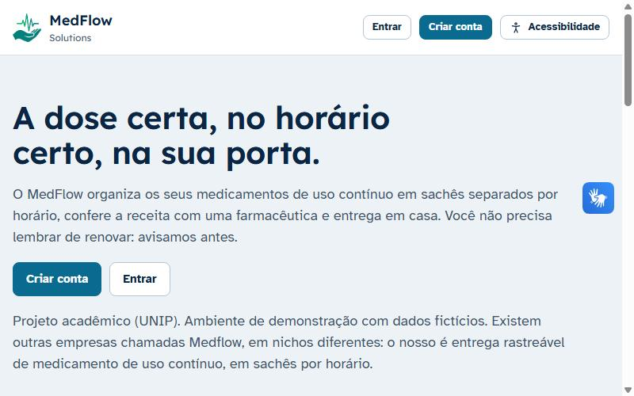

## Vídeo
O sistema completo em 3 minutos (abertura, página institucional, paciente com pagamento, farmacêutica, operador, entregador e acompanhamento): [`docs/video/medflow-fluxo-completo.mp4`](docs/video/medflow-fluxo-completo.mp4). O arquivo vem junto quando você baixa ou clona o repositório.

## Sumário
1. [O que o sistema faz](#o-que-o-sistema-faz)
2. [Telas](#telas)
3. [Contas de teste](#contas-de-teste)
4. [Como abrir o sistema](#como-abrir-o-sistema)
5. [Roteiro de 5 minutos para conhecer](#roteiro-de-5-minutos-para-conhecer)
6. [Abrir no celular](#abrir-no-celular)
7. [App Android](#app-android)
8. [Testes](#testes)
9. [Como o projeto é organizado](#como-o-projeto-é-organizado)
10. [Banco de dados](#banco-de-dados)
11. [Segurança e LGPD](#segurança-e-lgpd)
12. [Limites conhecidos](#limites-conhecidos)
13. [Documentação](#documentação)
14. [Equipe](#equipe)

## O que o sistema faz
Quatro perfis, cada um vendo só o que precisa:

| Perfil | O que faz |
|---|---|
| **Paciente** | Envia a receita com consentimento específico, monta a Box (medicamentos, horários e dose), confirma, paga (pagamento simulado), acompanha a linha do tempo, vê a próxima renovação e exerce os direitos da LGPD (exportar, corrigir, revogar e excluir os dados). |
| **Administrador (farmacêutica RT)** | Analisa a receita (prescritor, CRM, datas, checklist de seis itens e conferência item a item), aprova ou recusa com motivo, gerencia estoque, usuários internos e vê o painel e os relatórios CSV. |
| **Funcionário (operador)** | Separa a Box com etiquetas por sachê e finaliza, o que dá a baixa definitiva no estoque. Acompanha pedidos e estoque. |
| **Entregador** | Vê só nome, endereço e quantidade de sachês. Inicia a rota, abre o endereço no mapa e confirma a entrega com o nome de quem recebeu (ou registra ocorrência). |

Regras principais:
- **Receita analisada por humano.** Só medicamento de categoria Comum e não termolábil entra na Box; antimicrobianos, controlados e termolábeis ficam fora.
- **Estoque por lote com FEFO** (vence primeiro, sai primeiro). A **reserva** acontece na confirmação do pedido, em transação, tudo ou nada, com controle de concorrência. A **baixa** acontece quando a Box é finalizada. Testado com 20 pedidos simultâneos sobre o mesmo lote: o reservado nunca passa do saldo.
- **Catálogo por programas de cuidado.** 81 medicamentos de uso contínuo (72 disponíveis ao paciente), organizados em hipertensão, diabetes, colesterol, tireoide, estômago, vitaminas e minerais, coração e circulação e outros cuidados, com busca e filtro na hora de montar a Box.
- **Pagamento simulado.** Ao confirmar, o estoque já fica reservado e o pedido aguarda o pagamento por alguns minutos, com contagem regressiva. Pagar leva o pedido à separação (ou à análise da receita); se o prazo vence, o pedido é cancelado e a reserva volta ao estoque. Os preços são fictícios e nenhuma cobrança real nem dado de pagamento existe. Na demonstração, dois botões ("Aprovar pagamento" e "Simular expiração") representam o retorno do meio de pagamento. Detalhes em `docs/CONTRATO_API.md`.
- **Renovação automática (assinatura simulada).** O paciente liga uma opção e, 5 dias antes de a Box acabar, o sistema pede a próxima com os mesmos medicamentos e horários e faz a cobrança sozinho (simulada). Só renova com receita aprovada e válida e sem outra Box em andamento; o paciente cancela quando quiser. Na demonstração há o botão "Simular renovação agora".
- **Fita de sachês.** No início do paciente, a Box aparece como uma fita de sachês, um por horário, com o dia, a hora e o que há dentro; a próxima dose fica em destaque.
- **Máquina de estados do pedido** (Aguardando pagamento, Pendente, Em separação, Aguardando entregador, Em rota, Entregue; Recusado e Cancelado), com histórico. Transição inválida é recusada pela API e também pelo banco.
- **Pontos de atenção entre medicamentos.** Ao revisar a Box, o paciente vê avisos de combinações a conferir (por exemplo, levotiroxina com omeprazol, ou sinvastatina com anlodipino), e a farmacêutica vê os mesmos avisos na análise da receita. É uma tabela de demonstração, baseada em bulas: informa e nunca bloqueia o pedido, e a validação é da farmacêutica responsável.
- **Previsão de reposição** por média móvel de 3 meses e **relatórios CSV** (estoque, lotes a vencer e entregas).
- **Acessibilidade:** tema claro (padrão), escuro e de alto contraste; tradução para Libras (VLibras); opção "Reduzir movimentos" (as animações viram apenas um esmaecer); varredura automática WCAG 2.1 A/AA sem violações nas telas verificadas.
- **Página institucional** em `/site`, com menu, telas do sistema e passo a passo; a página inicial (`/`) continua sendo a de demonstração. A abertura animada de 5 segundos aparece uma vez por sessão e tem botão "Pular".

## Telas
### Página institucional
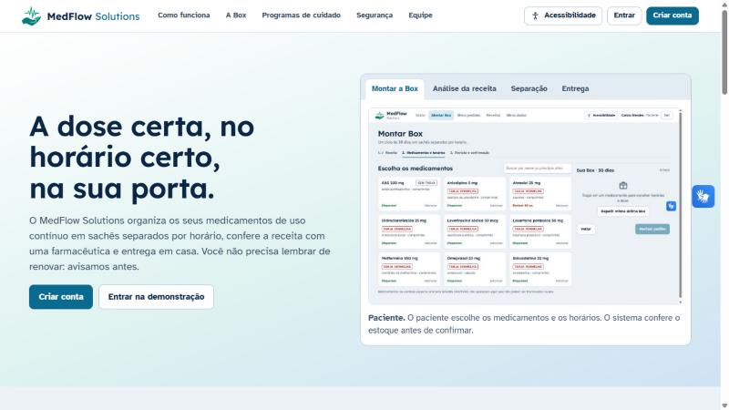

### Paciente
| Início | Montar Box | Meus pedidos |
|---|---|---|
| 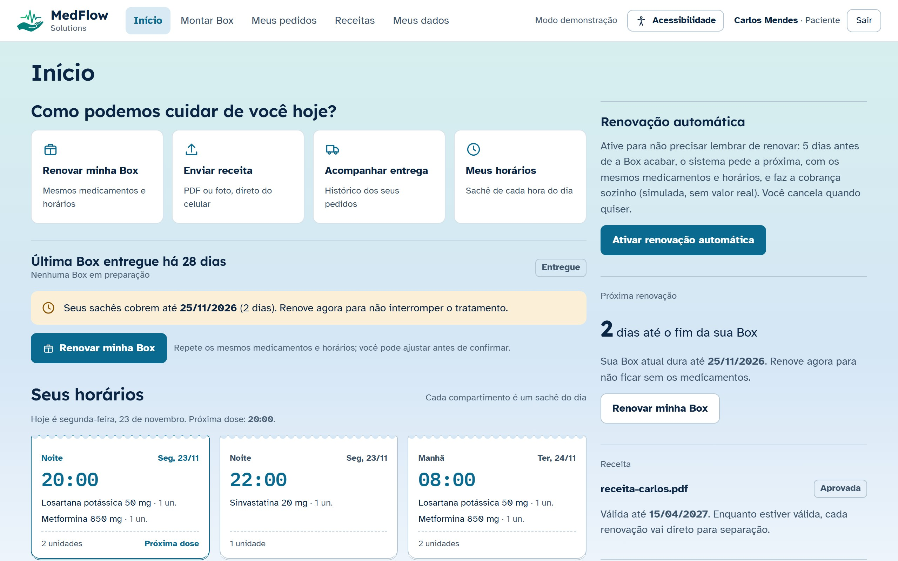 | 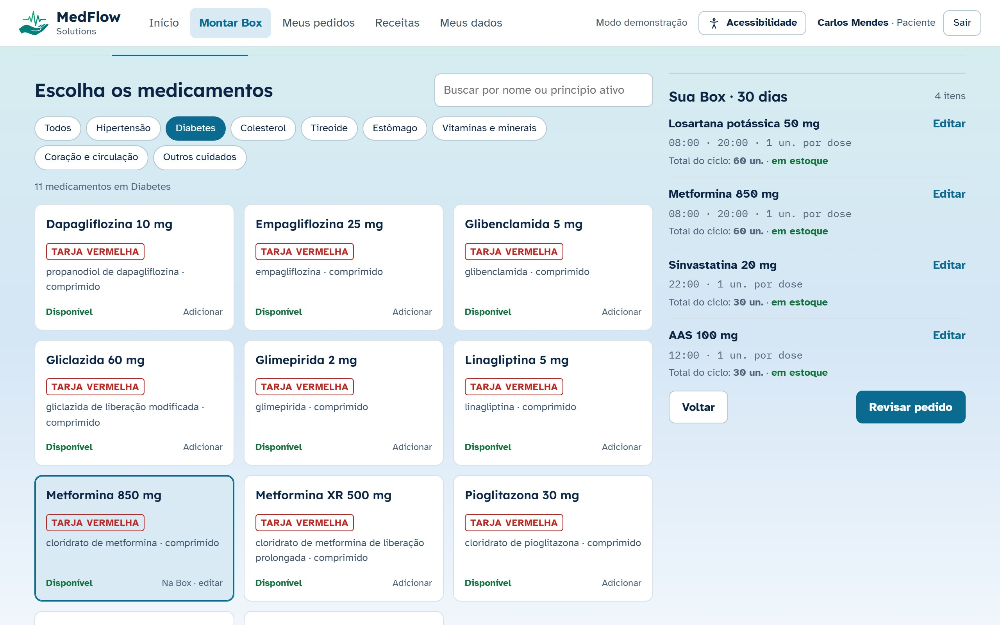 | 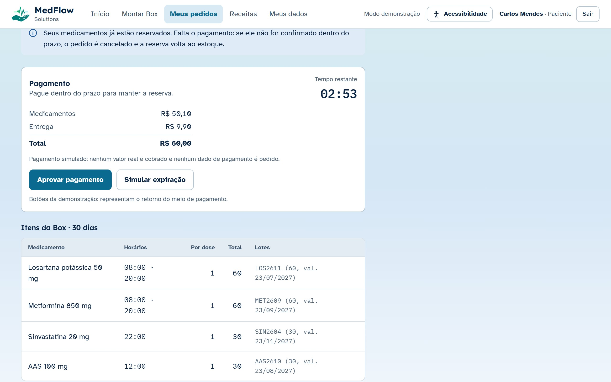 |

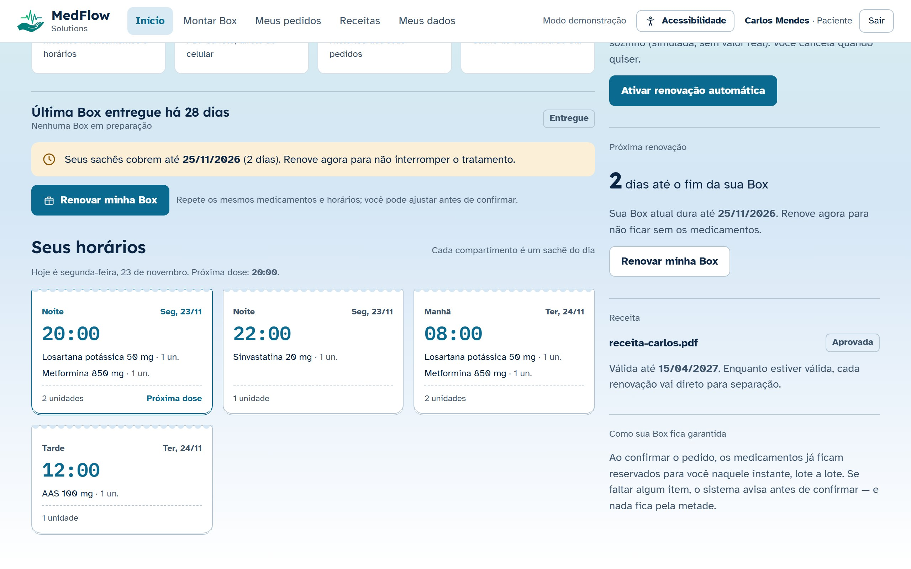

### Administrador (farmacêutica RT)
| Painel | Análise de receita |
|---|---|
| 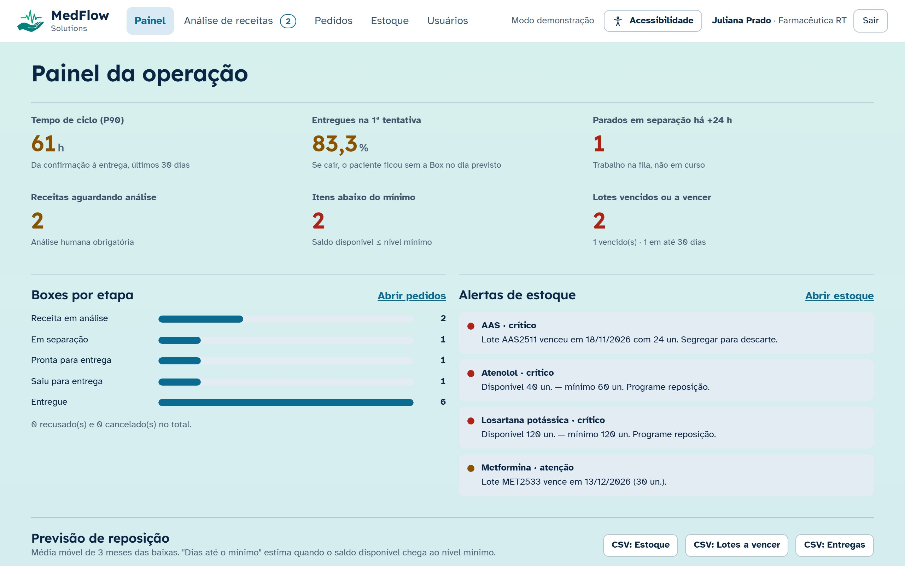 | 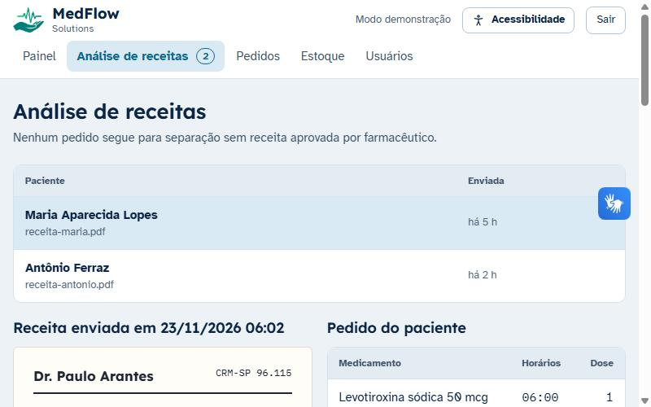 |

| Pedidos | Estoque | Usuários |
|---|---|---|
| 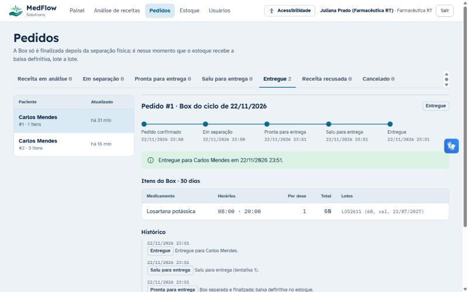 | 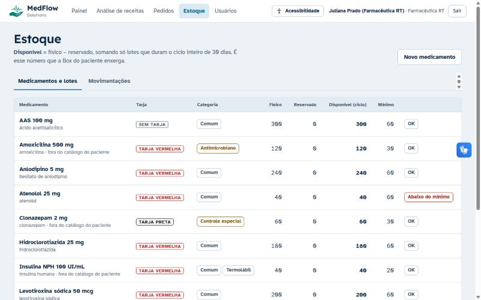 | 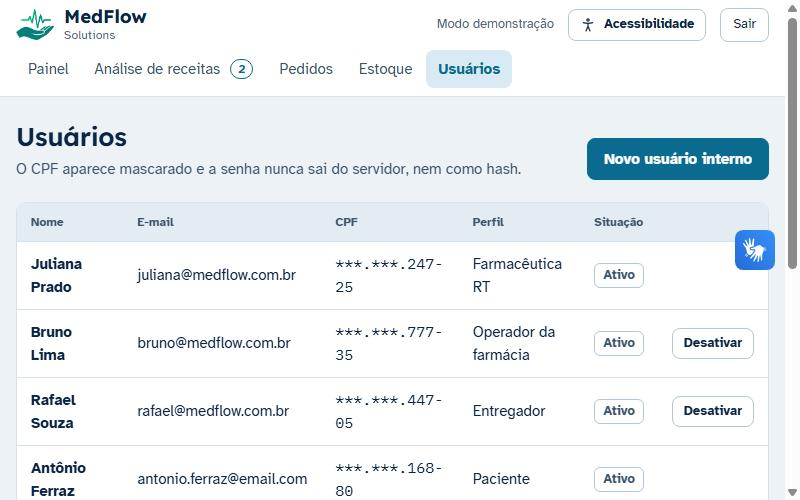 |

### Operador e entregador
| Separação com etiquetas | Entregador no celular |
|---|---|
| 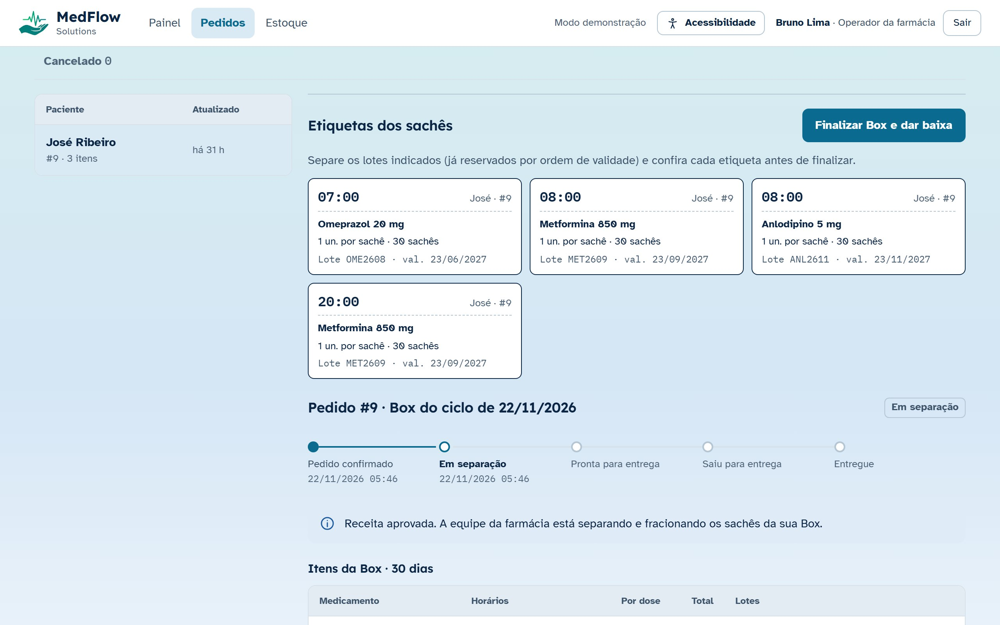 | 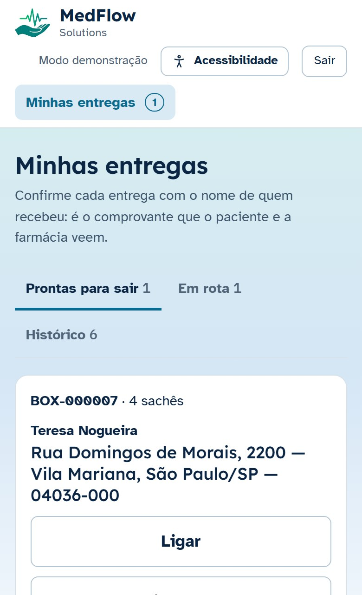 |

### App Android (entregador e paciente)
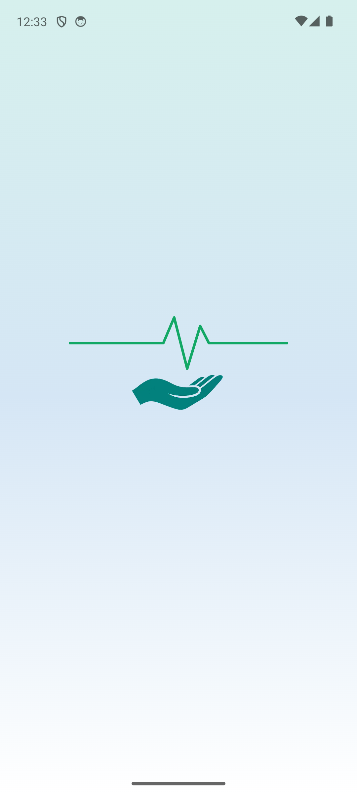 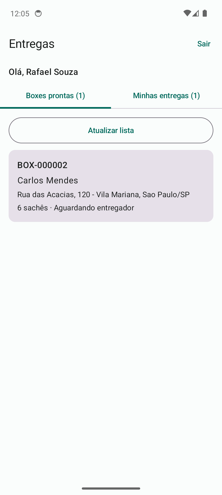 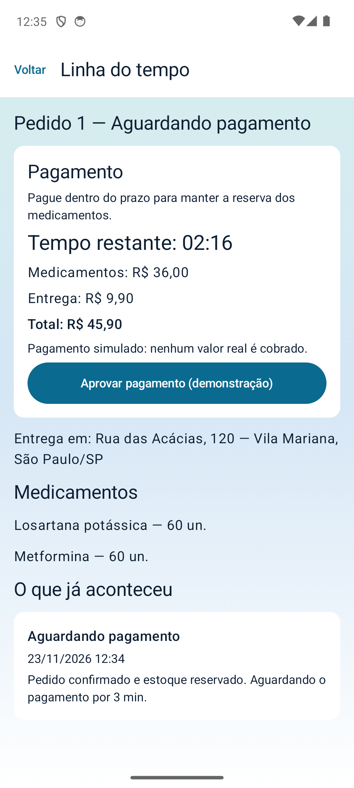

## Contas de teste
Dados fictícios, criados automaticamente quando a API roda em modo de desenvolvimento (ou com `Demo__Semear=true`).

| Perfil | E-mail | Senha |
|---|---|---|
| Paciente | `carlos@email.com` | `MedFlow2026` |
| Administrador (farmacêutica RT) | `juliana@medflow.com.br` | `MedFlow2026` |
| Funcionário (operador) | `bruno@medflow.com.br` | `MedFlow2026` |
| Entregador | `rafael@medflow.com.br` | `MedFlow2026` |

> Esta senha existe só para demonstração. Nunca use essa senha nem esses dados em um ambiente real.

## Como abrir o sistema
Escolha um dos dois caminhos.

### Caminho 1: só o site, em modo demonstração (2 minutos, sem banco e sem API)
Precisa de **Node 22 ou mais novo**.

```bash
git clone https://github.com/hendrewsantos/medflow-pim4.git
cd medflow-pim4/frontend
npm ci
npm run dev:demo
```
Abra **http://localhost:5173**. Nesse modo os dados ficam no navegador e existe uma barra no topo para trocar de perfil com um clique. Serve para olhar as telas; as regras de banco e de concorrência só existem no caminho 2.

### Caminho 2: sistema completo (site, API e banco)
Precisa de **.NET 8 SDK**, **Node 22 ou mais novo** e **Docker Desktop** aberto.

**1. Banco de dados** (MySQL 8.4 em contêiner, porta 3307):
```bash
docker compose up -d mysql
```

**2. API** (em desenvolvimento ela cria as tabelas e os dados fictícios sozinha). Em um terminal Git Bash:
```bash
cd backend
export ASPNETCORE_ENVIRONMENT=Development
export ConnectionStrings__MedFlow="server=localhost;port=3307;database=medflow;user=root;password=troque-esta-senha"
export Jwt__Chave="uma-chave-local-com-pelo-menos-32-caracteres"
dotnet run --project src/MedFlow.Api --urls http://localhost:5080
```
No PowerShell, troque `export NOME="valor"` por `$env:NOME = "valor"`. Teste: http://localhost:5080/health/ready deve responder 200. A documentação interativa da API fica em http://localhost:5080/swagger.

**3. Site** (outro terminal):
```bash
cd frontend
npm ci
npm run dev
```
Abra **http://localhost:5173** e entre com uma das [contas de teste](#contas-de-teste).

**Para parar:** `Ctrl+C` nos terminais e `docker compose down` (acrescente `-v` para apagar também os dados).

## Roteiro de 5 minutos para conhecer
1. Entre como **Paciente** (`carlos@email.com`). Em *Montar Box*, avance com a receita aprovada, escolha **Losartana**, marque 08:00 e 20:00, revise e confirme. O pedido vai para *Em separação* e o estoque é reservado por lote.
2. Saia e entre como **Funcionário** (`bruno@medflow.com.br`). Em *Pedidos*, veja as etiquetas por sachê e clique em **Finalizar Box e dar baixa**.
3. Entre como **Entregador** (`rafael@medflow.com.br`). Clique em **Iniciar rota** e depois **Confirmar entrega** informando o nome de quem recebeu.
4. Volte como **Paciente** e abra *Meus pedidos*: a linha do tempo mostra todas as etapas com data e hora.
5. Entre como **Administrador** (`juliana@medflow.com.br`). Veja o *Painel*, o *Estoque* (o saldo disponível só conta lotes que duram o ciclo inteiro), os *Usuários* e a *Análise de receitas*. Para ver a análise, envie uma receita nova como paciente (PDF, PNG ou JPG) e abra-a como administrador.

## Abrir no celular
**O celular e o computador precisam estar na MESMA rede Wi-Fi.** Nada é instalado no celular: ele só abre o endereço no navegador.

**Jeito rápido (Windows):** com o Docker Desktop aberto, rode na raiz do repositório
```powershell
./scripts/abrir-no-celular.ps1
```
O script descobre o IP do computador, sobe o banco, a API e o site e mostra o endereço para digitar no celular (algo como `http://192.168.0.10:5173`). Para só ver o endereço, sem subir nada: `./scripts/abrir-no-celular.ps1 -SomenteMostrar`.

**Jeito manual:**

1. Descubra o IP do computador (`ipconfig`, procure *Endereço IPv4*; vamos supor `192.168.0.10`).
2. Suba a API aceitando conexões da rede e liberando o site. Em Git Bash, a partir da pasta `backend`:
   ```bash
   export Cors__Origens__0="http://localhost:5173"
   export Cors__Origens__1="http://192.168.0.10:5173"
   dotnet run --project src/MedFlow.Api --urls http://0.0.0.0:5080
   ```
3. Suba o site apontando para essa API (pasta `frontend`):
   ```bash
   export VITE_API_URL="http://192.168.0.10:5080"
   npm run dev -- --host
   ```
4. No navegador do celular, abra `http://192.168.0.10:5173`.
5. Se não abrir, o Firewall do Windows está bloqueando: libere as portas 5080 e 5173 para redes privadas (ou aceite o aviso do Windows na primeira vez).

## App Android
Kotlin, Jetpack Compose, Retrofit, Room e WorkManager, nos perfis de entregador e paciente. O app usa a mesma identidade visual do site (degradê, paleta e abertura animada de 3 segundos, que respeita "remover animações" do sistema). O paciente vê o pedido com a contagem regressiva do pagamento simulado; na versão de depuração há o botão "Aprovar pagamento (demonstração)". Testado em emulador (Android 14) contra a API real: login do entregador e do paciente, lista de Boxes, iniciar rota, abrir mapa, confirmar entrega, pedido aguardando pagamento e aprovação.

O app só funciona com a **API e o banco de dados rodando** e alcançáveis pelo aparelho; o site (front-end) não precisa estar aberto.

1. Instale o **Android Studio** e abra a pasta `mobile`.
2. Em *Device Manager*, crie um emulador (Pixel, Android 14) e clique em **Run**. No emulador o app já aponta para a API do computador (`http://10.0.2.2:5080/`).
3. Para celular físico ou outra URL, veja `mobile/README.md`.

Pela linha de comando: `cd mobile && ./gradlew assembleDebug` (APK em `app/build/outputs/apk/debug/`).

## Testes
```bash
cd backend && dotnet test                      # 58 testes, sem MySQL
export MEDFLOW_TESTE_MYSQL="server=localhost;port=3307;user=root;password=troque-esta-senha"
dotnet test                                    # 59 testes (inclui a prova de concorrência em MySQL real)
cd ../frontend && npm test                     # 33 testes
python scripts/e2e_api.py                      # roteiro ponta a ponta contra a API (banco recém-criado)
cd ../mobile && ./gradlew testDebugUnitTest    # 18 testes de unidade do app
```
O CI do GitHub roda build, testes com MySQL, auditoria de dependências e imagens Docker a cada envio. Resultados registrados em `docs/AUDITORIA.md` e `docs/evidencias/`.

## Como o projeto é organizado
| Pasta | Conteúdo |
|---|---|
| `backend/` | API ASP.NET Core 8 em camadas: `MedFlow.Api` (controllers, segurança), `MedFlow.Core` (domínio e casos de uso), `MedFlow.Infrastructure` (EF Core, MySQL, migrações), `MedFlow.Tests` |
| `frontend/` | Site em Vue 3, Vite, Pinia e Vue Router |
| `mobile/` | App Android (Kotlin e Compose) |
| `database/` | Script SQL único e roteiro de verificação do banco |
| `docs/` | Contrato da API, auditoria, divergências em relação ao documento do trabalho, prints e evidências |
| `deploy/`, `docker-compose*.yml`, `.github/` | Contêineres (dev e produção com HTTPS automático via Caddy) e pipeline de CI |

Tecnologias: ASP.NET Core 8, EF Core 8 (Pomelo), MySQL 8.4, JWT, Vue 3, Kotlin, Docker, GitHub Actions.

## Banco de dados
- 14 tabelas, 4 procedimentos armazenados, 5 gatilhos, 4 visões e restrições CHECK.
- Migrações: `dotnet ef migrations list --project backend/src/MedFlow.Infrastructure` (antes, `dotnet tool restore`).
- Script único: `database/medflow_schema.sql` roda do zero em um MySQL 8.4 vazio.
- Verificação do comportamento: `database/testes_banco.sql` (saída em `database/resultado_testes_banco.txt`).
- Nota: a regra de estoque roda no serviço da API (transação do EF Core com versão de concorrência). Os procedimentos equivalentes existem no banco e foram testados à parte. Os gatilhos de transição de status e de imutabilidade das movimentações estão ativos nas operações da API.

## Segurança e LGPD
- Senha com PBKDF2-SHA256 (600 mil iterações), bloqueio após 5 falhas e token JWT de 60 minutos. O perfil vem do token, nunca do navegador.
- Autorização por política em cada rota, erros no padrão ProblemDetails, cabeçalhos de segurança (incluindo CSP), CORS restrito e verificação de saúde (`/health/live`, `/health/ready`).
- Dados de saúde só com consentimento específico e versionado. O paciente exporta, corrige, revoga e exclui (anonimização) os próprios dados. O entregador não vê itens, lotes nem receita.

## Limites conhecidos
- O app Android foi testado em emulador, não em celular físico.
- O suporte do .NET 8 termina em 10 de novembro de 2026; a migração para uma versão LTS atual é trabalho futuro.
- As regras sanitárias vêm de fontes documentais e não substituem o parecer de um farmacêutico responsável técnico.
- Não há hospedagem pública; a pilha de produção foi provada localmente (`docker-compose.prod.yml`, com `deploy/.env.example`).

## Documentação
- Contrato da API: [`docs/CONTRATO_API.md`](docs/CONTRATO_API.md)
- Auditoria e resultados reais: [`docs/AUDITORIA.md`](docs/AUDITORIA.md)

## Equipe
Grupo do PIM IV, UNIP, curso de Análise e Desenvolvimento de Sistemas (São Paulo, 2026). Orientador: Prof. André Gomes de Lira Muniz.

| Integrante | GitHub | LinkedIn |
|---|---|---|
| Gabriel Pimenta de Jesus | | [perfil](https://www.linkedin.com/in/gabriel-pimenta-790276360/) |
| Hendrew dos Santos Braz | [@hendrewsantos](https://github.com/hendrewsantos) | [perfil](https://www.linkedin.com/in/hendrew-santos2530) |
| Manuel Douglas Silva Alves | | [perfil](https://www.linkedin.com/in/mdouglas12/) |
| Matheus Renato Bento Estevo | [@MatheusRenat0](https://github.com/MatheusRenat0) | [perfil](https://www.linkedin.com/in/matheus-estevo-281582357/) |
| Matheus Santos Ribeiro | | [perfil](https://www.linkedin.com/in/matheus-santos-3733923a8/) |

O PIM III, que deu origem a este projeto, está no repositório original do grupo.

## Licença
Projeto acadêmico. Ainda não há licença de uso definida; o código está aberto para consulta e avaliação.
